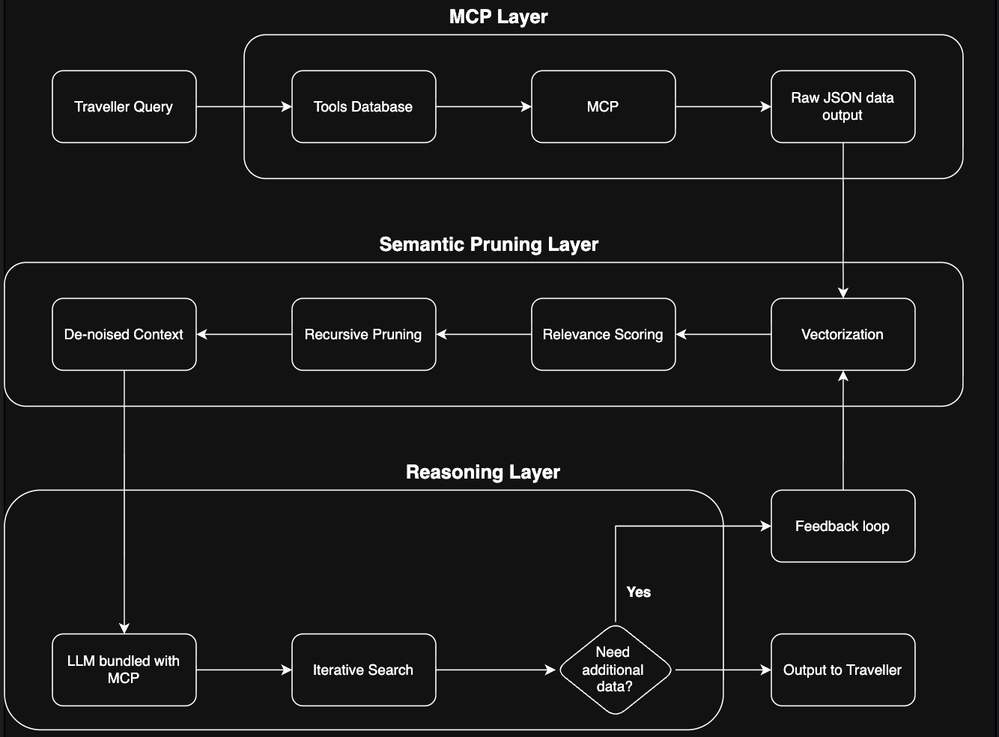

# Semantic-Aware MCP Gateway for Agentic Travel Planning

Code, raw results and reproduction instructions for the MSc thesis
*Optimizing Context Efficiency in Multi-Agent Systems using Agentic AI* (Harsh Kansal, LJMU).

The study compares two otherwise identical Reason-Act travel-planning agents on the
[TravelPlanner](https://arxiv.org/abs/2402.01622) benchmark (validation split, 180 queries):

* **Baseline** - raw tool output is appended to the agent's context unchanged.
* **Gateway** - every tool response first passes through a Semantic Pruning Layer
  (row-level embeddings, adaptive cosine threshold, constraint-aware price floor, cached
  `fetch_more` recovery of pruned rows).

Metrics: Task Completion Rate (TCR), Constraint Satisfaction Rate (CSR), tokens per query
(Token-to-Signal Ratio) and latency.

| Matched sample, n = 57 pairs | Baseline | Gateway | Test | p |
|---|---|---|---|---|
| TCR | 61.4% | 56.1% | two-proportion z | 0.57 |
| CSR | 87.7% | 85.5% | Welch t | 0.52 |
| Tokens / query | 14,476 | 10,122 (-30.1%) | Welch t | <0.0001 |
| Latency (s) | 16.5 | 17.1 | Welch t | 0.31 |



## Repository layout

```
src/
  config.py              all paths + env-var settings (model, temperature, price floor, max steps)
  data_loader.py         TravelPlanner validation loader, stratified/offset sampling
  tools/registry.py      Tool Access Layer: 5 tool endpoints over the local tool database
  semantic_gateway.py    Semantic Pruning Layer: embed -> score -> adaptive threshold -> price floor
  agents/base_agent.py   Reason-Act loop + system prompt (shared by both conditions)
  agents/baseline_agent.py, gateway_agent.py   the two experimental conditions
  llm_provider.py        OpenAI / Gemini client, token + latency accounting, retry policy
  constraint_checker.py  scoring: budget / local-constraint / day-coverage checks -> TCR, CSR
  metrics.py             per-query record + run summary
  run_experiment.py      CLI to run a condition over a query sample
  analyze.py             matched-pair statistics (reproduces Tables 5.1 / 5.2)
scripts/                 reproduce_results.sh, benchmark_pruning.py (times the pruning step), make_figures.py (redraws every chart)
results/final/           per-query records behind every reported number (JSON Lines)
results/diagnostics/     floor-3 vs floor-6 sensitivity run (thesis Sec. 5.3.1)
results/superseded/      early pilot runs, kept for transparency, not used in any statistic
docs/BATCHES.md          exact configuration and commands for each collection batch
docs/FINAL_SUMMARY.md    one-page results summary and known limitations
data/                    put the TravelPlanner data here (see data/README.md)
```

## 1. Reproduce the reported statistics (no API key, no dataset)

```bash
python -m venv .venv && source .venv/bin/activate
pip install -r requirements.txt          # or requirements-lock.txt for exact versions
./scripts/reproduce_results.sh           # = python -m src.analyze --final
```

This recomputes the thesis tables from `results/final/*.jsonl`. To redraw every chart in the thesis from the same files:

```bash
python scripts/make_figures.py          # writes PNGs to docs/figures/ (dataset chart needs data/)
```

## 2. Re-run the experiments

Requires an OpenAI API key with access to `gpt-5.2`, and the dataset in `data/`.

```bash
cp .env.example .env     # add OPENAI_API_KEY, then:  set -a; source .env; set +a
python -m src.run_experiment --agent baseline --n-per-level 3 --out my_baseline.jsonl
python -m src.run_experiment --agent gateway  --n-per-level 3 --out my_gateway.jsonl
python -m src.analyze --baseline my_baseline.jsonl --gateway my_gateway.jsonl
```

`docs/BATCHES.md` lists the exact flags/environment for each batch behind the thesis numbers.
The first use of the embedding model downloads `all-MiniLM-L6-v2` from Hugging Face.

**Cost warning:** a Baseline query costs roughly 14k tokens and runaway queries can exceed 60k;
set a spend limit on the API key before large runs.

## Reproducibility notes and limitations

* `gpt-5.2` is **not deterministic even at temperature 0** (thesis Sec. 5.3.2). Re-running gives
  statistically similar, not identical, per-query outcomes. The committed records are the evidence.
* Batches 1-3 ran with API-default temperature and a price floor of 3; batch 4 with temperature 0
  and a floor of 6 (`docs/BATCHES.md`). Defaults in this repo match batch 4.
* Scoring in `constraint_checker.py` is a re-implementation (the official TravelPlanner evaluator is
  not part of the data release): the budget is parsed from a `Total Cost` line and the local
  constraints (house rule, cuisine, room type, transportation) are checked by keyword presence in
  the plan text. It does not verify that each cited item actually exists in the tool data.
* The stored records do not contain plan text (it was not saved for the four batches); new runs now store it in `plan_text`.
* Pinned versions were captured on Python 3.14 / macOS (`requirements-lock.txt`).

## Citation

Xie, J. et al. (2024) TravelPlanner: A Benchmark for Real-World Planning with Language Agents.
arXiv:2402.01622. Thesis: Kansal, H. (2026), Liverpool John Moores University.
